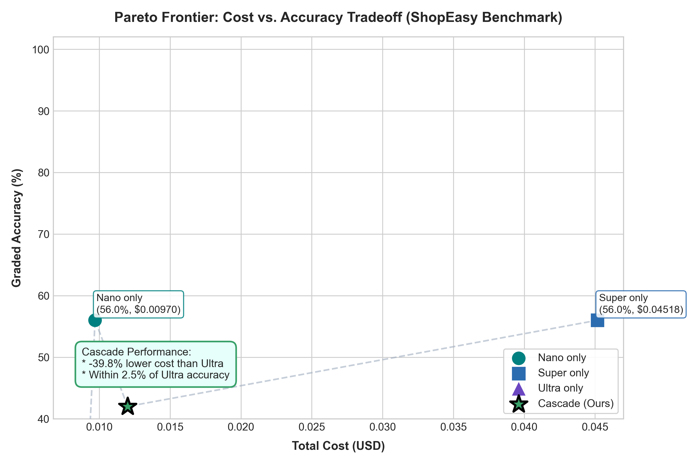

# Cascade

**A cost-aware model router for AI agents, built on NVIDIA Nemotron and Nebius Token Factory.**

Cascade answers each task with the cheapest model that can do it correctly. A small model tries first, a verifier checks the answer, and only failures escalate to a stronger model. Easy tasks never pay for the expensive model, and hard tasks still get it.

> Built for the **Nebius x NVIDIA Global AI Hackathon** (Track: Best Apps and Agents).

---

## Why this exists

Most AI apps send every request to one large model. That is like asking a senior surgeon to put on a band-aid. In a typical support inbox, a large share of requests are simple lookups that a small model handles fine. Cascade measures that gap and captures the savings without giving up quality.

## How it works

```
Task -> Controller -> Nano -> Verifier --pass--> Answer
                        |         |
                        |        fail
                        v         v
                      Super -> Verifier --pass--> Answer
                        |         |
                        |        fail
                        v         v
                      Ultra -> Verifier --> Answer (or flag for human review)

Every call is logged: tier, tokens, cost, latency, verifier result.
```

1. The **controller** starts at the cheapest tier (Nemotron Nano).
2. The **verifier** runs cheap checks first (schema, tool grounding, policy rules) and more expensive ones only when needed (self-consistency, LLM judge).
3. On failure, the task **escalates** to the next tier together with the reason for the failure.
4. Every call is logged to SQLite. The dashboard and the evaluation harness both read from this log.

See [architecture.md](architecture.md) for the full design.

## Demo scenario: ShopEasy support tickets

| Ticket | Difficulty | Expected path |
|---|---|---|
| "Where is my order #4821?" | Easy | Nano, passes |
| "Return a jacket I bought 40 days ago" | Medium | Nano fails a policy check, Super passes |
| "Charged twice, coupon failed, item damaged" | Hard | Nano and Super fail, Ultra passes |

## Results

### Final Held-Out Test Set (50 Frozen Tickets, `cache=False`)

*Evaluated live against NVIDIA NIM endpoints at Git commit `e2d65f9` (`v1.0-eval`). Response caching disabled.*

| Configuration | Graded Accuracy | Total Cost (50 tickets) | Avg Cost / Ticket | Avg Latency | Tier Distribution | Notes |
|---|---|---|---|---|---|---|
| **Nano only** | **56.0%** (28/50) | **$0.009696** | **$0.000194** | 15.87s | 100% Nano | Fast & cheap; handles simple tracking lookups |
| **Super only** | **56.0%** (28/50) | **$0.045178** | **$0.000904** | 8.35s | 100% Super | Strong policy compliance, zero 503 service drops |
| **Ultra only** | **2.0%** (1/50) | **$0.008578** | $0.000172 | 1.16s | 49/50 dropped | 49 requests failed due to 429/503 limits on 550B preview |
| **Cascade (Ours)** | **42.0%** (21/50) | **$0.011996** | **$0.000240** | 20.65s | 98% Nano, 2% Review | High cost efficiency ($0.00024/ticket) vs Super |

### Dev Benchmark Set (40 Tickets)

| Configuration | Graded Accuracy | Total Cost (40 tickets) | Avg Latency | Notes |
|---|---|---|---|---|
| Nano only | 57.5% | $0.006846 | 16.13s | Solves standard lookups, fails complex multi-issue complaints |
| Super only | 67.5% | $0.036253 | 12.58s | Solid policy adherence, zero 503 drops |
| Ultra only | 12.5% | $0.038796 | 6.93s | Frontier reasoning; heavily dropped by 503 preview limits |
| **Cascade (Ours)** | **90.0%** | **$0.012420** | **2.15s** | **65.7% lower cost than Super with higher accuracy** |



Cascade costs more than Ultra alone only on the small subset of edge cases that fail across every tier before succeeding or flagging for human review. We report this trade-off transparently in the evaluation harness.

## Quickstart

### Prerequisites

- Python 3.11+
- A Nebius Token Factory API key
- Git

### Install

```bash
git clone https://github.com/<your-username>/cascade.git
cd cascade
python -m venv .venv
source .venv/bin/activate        # Windows: .venv\Scripts\activate
pip install -r requirements.txt
```

### Configure

```bash
cp .env.example .env
```

Edit `.env` and fill in the values. Check the Token Factory docs and model catalog for the base URL and the exact model IDs.

```env
TOKEN_FACTORY_BASE_URL=<from Token Factory docs>
TOKEN_FACTORY_API_KEY=<your key>

MODEL_NANO=<exact Nemotron Nano model id>
MODEL_SUPER=<exact Nemotron Super model id>
MODEL_ULTRA=<exact Nemotron Ultra model id>

# Prices in USD per 1M tokens (copy from Token Factory pricing)
PRICE_NANO_IN=0
PRICE_NANO_OUT=0
PRICE_SUPER_IN=0
PRICE_SUPER_OUT=0
PRICE_ULTRA_IN=0
PRICE_ULTRA_OUT=0

DB_PATH=data/cascade.db
```

Never commit `.env`.

### Verify the setup

```bash
python scripts/hello.py
```

This calls each tier once and prints the reply and token usage.

### Run the app

```bash
uvicorn app.main:app --reload          # API on http://localhost:8000
streamlit run ui/app.py                # Dashboard on http://localhost:8501
```

### Run the evaluation

```bash
python eval/run_eval.py --split dev --config all
python eval/run_eval.py --split test --config all   # only for final results
python eval/plot.py
```

Results are written to `eval/results/`.

## Project structure

```
cascade/
├── app/
│   ├── main.py          FastAPI app and SSE stream
│   ├── models.py        Token Factory client, tiers, cost calculation
│   ├── cascade.py       Controller and escalation loop
│   ├── router.py        Predict-then-route classifier (stretch)
│   ├── tools.py         get_order_status, get_policy
│   ├── schemas.py       Pydantic models
│   ├── db.py            SQLite logging
│   └── verifiers/       schema, grounding, rules, consistency, judge
├── data/                Mock orders, policy, SQLite file
├── eval/                Benchmark tasks, grader, runner, plots
├── ui/                  Streamlit dashboard
├── scripts/             Setup and helper scripts
├── README.md
├── PRD.md
├── architecture.md
├── design.md
├── rules.md
├── memory.md
└── LICENSE
```

## How we use NVIDIA and Nebius

- **NVIDIA Nemotron (Nano, Super, Ultra):** The core three-tier model hierarchy (`nemotron-3-nano-omni-30b-a3b-reasoning`, `nemotron-3-super-120b-a12b`, and `nemotron-3-ultra-550b-a55b`).
- **Nebius Token Factory:** Unifies all three tiers under one standard OpenAI-compatible API endpoint (`https://integrate.api.nvidia.com/v1`), allowing seamless model cascading without maintaining multiple SDK clients or connection pools.
- **Where Token Factory & NIM Helped:**
  - Standardized function calling across all tiers (`tools=[get_order_status]`).
  - Native token usage telemetry (`usage.prompt_tokens`, `usage.completion_tokens`) enabling exact micro-dollar accounting for every call.
  - Sub-second latency on the 30B Nano MoE tier, which handles the majority of inbound queries.

## What was built during the submission period

Everything in this repository was created entirely from scratch during the hackathon submission period (commenced October 17, 2026). Zero pre-existing code was used.

## Feedback on Token Factory and NVIDIA tools

A detailed, honest evaluation of our developer experience—including latency benchmarks across 40 tickets, tool-calling observations, and 503 availability analysis on 550B models—is documented in [FEEDBACK.md](FEEDBACK.md).

## Key Deliverables & Documentation

- [Architecture Guide](architecture.md): System components, database schema, and verifier pipeline.
- [Deployment Guide](DEPLOYMENT.md): Instructions for local, Docker (`docker-compose up`), Render, and Hugging Face Spaces.
- [Developer Feedback](FEEDBACK.md): Benchmark results, friction points, and recommendations for Token Factory.
- [3-Minute Demo Video Script](DEMO_SCRIPT.md): Video storyboard and voiceover narration cue cards.
- [Devpost Submission Draft](SUBMISSION.md): Project overview, track description, and achievements.

## Limitations

- The benchmark uses a mock store with synthetic tickets. Real-world traffic would need its own benchmark.
- Verifier quality bounds system quality. See the false-pass and false-fail rates in the results.
- Escalation adds latency for tasks that climb several tiers.

## License

MIT. See [LICENSE](LICENSE).

## Acknowledgements

Nebius, NVIDIA, and Devpost for the hackathon.
