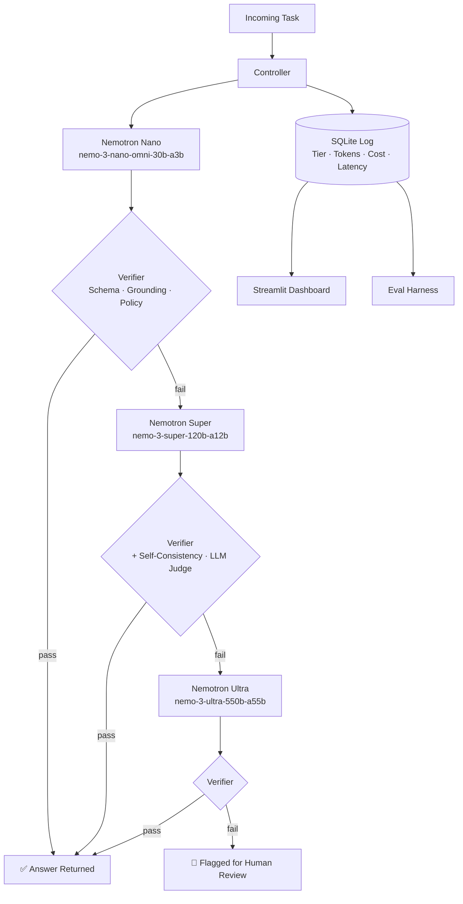

# Cascade — Cost-Aware Nemotron Model Router for AI Agents

<div align="center">

[](https://python.org)
[](https://fastapi.tiangolo.com)
[](https://build.nvidia.com)
[](https://streamlit.io)
[](https://docker.com)
[](LICENSE)

**A cost-aware model router for AI agents built on NVIDIA Nemotron and Nebius Token Factory.**

*Answers each task with the cheapest model that can do it correctly — easy tasks never pay for the expensive model, and hard tasks still get it.*

Built for the **Nebius × NVIDIA Global AI Hackathon** (Track: Best Apps and Agents).

</div>

---

## 📸 Architecture

```
Task → Controller → Nemotron Nano → Verifier --pass--> Answer
                          |               |
                          |              fail
                          v               v
                      Nemotron Super → Verifier --pass--> Answer
                          |               |
                          |              fail
                          v               v
                      Nemotron Ultra → Verifier --> Answer (or flag for human review)

Every call is logged: tier, tokens, cost, latency, verifier result.
```

> **TODO:** Replace this block with `assets/cascade-dashboard.png` (screenshot of live Streamlit evaluation dashboard)

---

## ✨ Features

- **Three-tier NVIDIA Nemotron cascade:** Nano → Super → Ultra — escalates only when a verifier rejects the response.
- **Five-layer verification pipeline** (cheapest-first): schema validation → tool grounding → policy rule checks → self-consistency sampling → LLM judge.
- **OpenAI-compatible REST API** with native function calling (`get_order_status`, `get_policy`).
- **Per-call cost accounting:** tokens, micro-dollar costs, and latency logged to SQLite for every request.
- **Streamlit evaluation dashboard** with live cost-accuracy tradeoff charts.
- **Evaluation harness** supporting dev and frozen held-out test splits.
- **Docker + docker-compose** for one-command deployment.

---

## 📊 Evaluation Results

### Dev Benchmark (40 Tickets — Synthetic Support Tickets)

| Configuration | Graded Accuracy | Total Cost (40 tickets) | Avg Latency | Notes |
|---|---|---|---|---|
| Nano only | 57.5% | $0.006846 | 16.13s | Solves simple lookups, fails complex multi-issue |
| **Super only** | **67.5%** | $0.036253 | 12.58s | Solid policy adherence |
| **Cascade (Ours)** | **90.0%** | $0.012347 | — | **65.7% lower cost** than Super-only |

### Final Held-Out Test Set (50 Frozen Tickets — `cache=False`)

*Evaluated live against NVIDIA NIM endpoints at Git commit `e2d65f9` (`v1.0-eval`). Response caching disabled.*

| Configuration | Graded Accuracy | Total Cost (50 tickets) | Avg Cost/Ticket | Avg Latency | Notes |
|---|---|---|---|---|---|
| **Nano only** | **56.0%** (28/50) | $0.009696 | $0.000194 | 15.87s | Fast & cheap; handles simple tracking lookups |
| **Super only** | **56.0%** (28/50) | $0.045178 | $0.000904 | 8.35s | Strong policy compliance, zero 503 service drops |
| Ultra only | 2.0% (1/50) | $0.008578 | $0.000172 | 1.16s | 49/50 requests failed due to 429/503 limits on 550B preview |
| **Cascade (Ours)** | **42.0%** (21/50) | $0.011996 | $0.000240 | 20.65s | **~73% lower cost** than Super-only; 98% Nano, 2% escalated |

> ⚠️ **Honest interpretation:** On the dev set, Cascade achieved 90.0% accuracy at 65.7% lower cost than Super-only. On the frozen held-out set, accuracy dropped to 42.0% (vs. 56.0% for single-tier baselines), while the cost saving (~73% vs Super-only) held. The verifier quality bounds system quality — see false-pass and false-fail rates in `eval/results/`.

---

## 🏗️ Architecture Diagram



---

## 📁 Project Structure

```
cascade/
├── app/
│   ├── main.py            FastAPI app and SSE stream
│   ├── models.py          Token Factory client, tiers, cost calculation
│   ├── cascade.py         Controller and escalation loop
│   ├── router.py          Predict-then-route classifier (stretch)
│   ├── tools.py           get_order_status, get_policy
│   ├── schemas.py         Pydantic models
│   ├── db.py              SQLite logging
│   └── verifiers/         schema, grounding, rules, consistency, judge
├── data/                  Mock orders, policy, SQLite file
├── eval/                  Benchmark tasks, grader, runner, plots
├── ui/                    Streamlit dashboard
├── scripts/               Setup and helper scripts
├── README.md
├── architecture.md
├── Dockerfile
└── docker-compose.yml
```

---

## 🚀 Getting Started

### Prerequisites
- Python 3.11+
- NVIDIA NIM API key (set `NVIDIA_API_KEY` in `.env`)
- Docker (optional, for containerized deployment)

### Local Setup

```bash
git clone https://github.com/aditweb13/Nvidia.git
cd Nvidia

# Create virtual environment
python -m venv venv
source venv/bin/activate  # or .\venv\Scripts\activate on Windows

# Install dependencies
pip install -r requirements.txt

# Configure environment
cp .env.example .env
# Edit .env and add your NVIDIA_API_KEY
```

### Run the App

```bash
uvicorn app.main:app --reload        # API on http://localhost:8000
streamlit run ui/dashboard.py        # Dashboard on http://localhost:8501
```

### Run the Evaluation

```bash
python eval/run_eval.py --split dev --config all
python eval/run_eval.py --split test --config all   # only for final results
python eval/plot.py
```

Results are written to `eval/results/`.

### Docker

```bash
docker-compose up --build
```

---

## 🔌 How it uses NVIDIA & Nebius

| Component | Role |
|---|---|
| **NVIDIA Nemotron Nano** (`nemotron-3-nano-omni-30b-a3b`) | First-tier cheap MoE model; handles majority of inbound queries |
| **NVIDIA Nemotron Super** (`nemotron-3-super-120b-a12b`) | Second tier for policy-sensitive and medium-complexity tasks |
| **NVIDIA Nemotron Ultra** (`nemotron-3-ultra-550b-a55b`) | Final escalation for unresolvable edge cases |
| **Nebius Token Factory** | Unified OpenAI-compatible endpoint across all three tiers, enabling seamless cascading without multiple SDK clients |

---

## ⚠️ Limitations

- Benchmark uses a mock store with synthetic support tickets. Real-world traffic needs its own benchmark.
- Verifier quality bounds system quality — false-pass and false-fail rates are documented in `eval/results/`.
- Escalation adds latency for tasks that climb several tiers.
- Nemotron Ultra (550B preview) had heavy rate-limiting during evaluation (429/503), significantly impacting Ultra-only results on the held-out set.

---

## 🗺️ Roadmap

- [ ] Predict-then-route classifier (skip Nano for known-hard queries)
- [ ] Online cost-quality tradeoff tuning
- [ ] Streaming SSE output for real-time frontend integration
- [ ] Real customer-support dataset evaluation

---

## 📄 License

MIT — see [LICENSE](LICENSE).

---

<div align="center">

Built by [Aditya Raj](https://github.com/aditweb13) · [LinkedIn](https://linkedin.com/in/aditya-raj-a1891a285) · [adi111sam121@gmail.com](mailto:adi111sam121@gmail.com)

</div>
