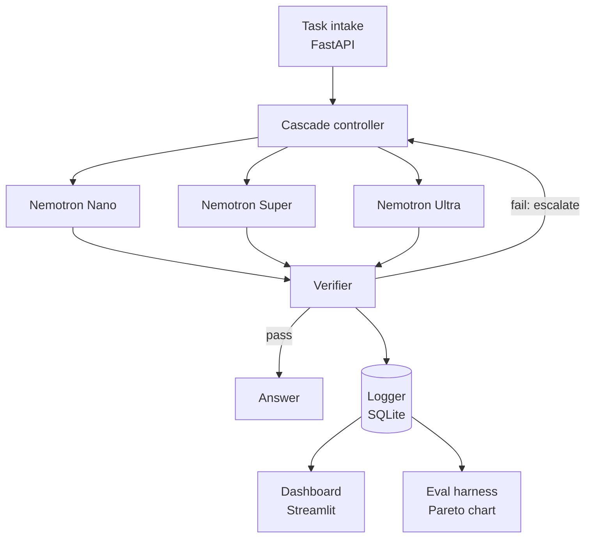
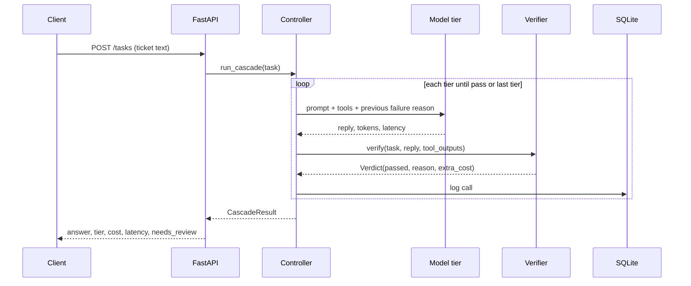

# Architecture

How Cascade is built. Companion to [`PRD.md`](PRD.md) (what) and [`design.md`](design.md) (UI).

## 1. Overview



Two paths share one log:

- **Decision path:** intake -> controller -> model tier -> verifier -> answer or escalate.
- **Observability path:** every call is written to SQLite, which feeds the live dashboard and the offline evaluation.

## 2. Components

| Component | File | Responsibility |
|---|---|---|
| Intake API | `app/main.py` | `POST /tasks`, `GET /stream` (SSE), `GET /stats` |
| Controller | `app/cascade.py` | Per-task state machine, tier selection, escalation with feedback |
| Model client | `app/models.py` | Token Factory calls, retries, token and cost accounting |
| Tools | `app/tools.py` | `get_order_status`, `get_policy` over mock data |
| Verifiers | `app/verifiers/` | Pass/fail with a reason, cheapest first |
| Router (stretch) | `app/router.py` | Predicts the starting tier before the first call |
| Logger | `app/db.py` | SQLite writes and reads |
| Schemas | `app/schemas.py` | Pydantic models for tasks, replies, verdicts |
| Eval harness | `eval/` | Benchmark, grader, plots |
| Dashboard | `ui/dashboard.py` | Live routing view and cost counter |

## 3. Request lifecycle



## 4. Controller logic

```
tiers = [nano, super, ultra]
feedback = None
for tier in tiers:
    result  = call_model(tier, task, feedback)
    verdict = run_verifiers(task, result)         # cheapest first, stop on first fail
    log_call(task, tier, result, verdict)
    if verdict.passed:
        return Result(answer=result, tier=tier, needs_review=False)
    feedback = verdict.reason                      # given to the next tier
return Result(answer=result, tier=tiers[-1], needs_review=True)
```

Rules:

- Escalation passes the failure reason, so the next tier does not start blind.
- The last tier's answer is returned but flagged `needs_review` if it also fails.
- Total cost for a task is the sum of every model call plus verifier overhead.
- Model errors (timeouts, 429, 5xx) are retried with backoff. After retries, the controller escalates as if verification failed, with the reason `model_error`.

## 5. Verifiers

Run in this order. Stop at the first failure.

| Order | Verifier | Cost | What it checks |
|---|---|---|---|
| 1 | Schema | Free | Output parses into the Pydantic reply model (decision, message, order id) |
| 2 | Grounding | Free | Every date, amount and status in the reply appears in tool output |
| 3 | Rules | Free | Deterministic policy logic (for example refund approved after 30 days fails) |
| 4 | Self-consistency | 3 Nano calls | Three samples agree on the structured decision |
| 5 | LLM judge | 1 Super call | Reply addresses every issue extracted from the ticket |

Verifiers 4 and 5 only run when they are enabled in config and the cheaper checks passed. They count toward task cost.

Common interface:

```python
@dataclass
class Verdict:
    passed: bool
    reason: str
    cost: float = 0.0

def verify(task, reply, tool_outputs) -> Verdict: ...
```

## 6. Model client

- Uses the `openai` Python SDK with the Token Factory base URL (OpenAI-compatible API, confirm in the Nebius docs).
- One function: `call_model(tier, messages, tools=None) -> ModelResult`.
- Cost = `tokens_in * price_in + tokens_out * price_out`, with prices from `.env`.
- Self-consistency samples run concurrently with `asyncio.gather`.
- Response caching keyed by `(tier, prompt hash, temperature)` is enabled in development to save credits and disabled for the final benchmark.

```python
@dataclass
class ModelResult:
    text: str
    tokens_in: int
    tokens_out: int
    cost: float
    latency: float
```

## 7. Data model (SQLite)

```sql
CREATE TABLE tasks (
  task_id        TEXT PRIMARY KEY,
  ticket_text    TEXT NOT NULL,
  split          TEXT,               -- dev | test | live
  config         TEXT,               -- nano | super | ultra | cascade
  final_tier     TEXT,
  final_reply    TEXT,
  needs_review   INTEGER DEFAULT 0,
  total_cost     REAL,
  total_latency  REAL,
  correct        INTEGER,            -- set by the grader
  created_at     TEXT
);

CREATE TABLE calls (
  id             INTEGER PRIMARY KEY AUTOINCREMENT,
  task_id        TEXT NOT NULL REFERENCES tasks(task_id),
  attempt        INTEGER,
  tier           TEXT,
  tokens_in      INTEGER,
  tokens_out     INTEGER,
  cost           REAL,
  latency        REAL,
  verifier       TEXT,               -- which verifier produced the verdict
  verdict        TEXT,               -- pass | fail
  reason         TEXT,
  created_at     TEXT
);
```

The dashboard and the evaluation both read only from these two tables.

## 8. API

| Method | Path | Purpose |
|---|---|---|
| POST | `/tasks` | Submit a ticket, returns `CascadeResult` |
| GET | `/tasks/{id}` | Fetch a task and its calls |
| GET | `/stream` | Server-Sent Events: one event per call as it is logged |
| GET | `/stats` | Totals: cost, tier distribution, savings vs. Ultra-only |
| POST | `/benchmark/replay` | Replay sample tickets for the demo |

`CascadeResult`:

```json
{
  "task_id": "t_0042",
  "answer": "...",
  "tier": "super",
  "attempts": 2,
  "cost": 0.0,
  "latency": 0.0,
  "needs_review": false,
  "history": [{"tier": "nano", "verdict": "fail", "reason": "refund approved outside 30-day window"}]
}
```

## 9. Evaluation architecture

```
eval/tasks.jsonl --> run_eval.py --> (4 configs) --> SQLite --> grader.py --> results/*.csv --> plot.py --> pareto.png
```

- Four configurations run on the same tasks: `nano`, `super`, `ultra`, `cascade`.
- The grader is deterministic: decision match, required facts present, checklist coverage. An LLM judge is used only for optional quality checks, with a different model from the one under test.
- Dev split (40) is for tuning. Test split (50) is frozen and run once.
- Reported metrics: accuracy, total cost (including verifier overhead), average latency, tier distribution, false-pass rate, false-fail rate.

## 10. Configuration

All via `.env` (see README): base URL, API key, three model IDs, six prices, DB path. Feature flags (enable self-consistency, enable judge, routing strategy) live in `config.yaml` or environment variables, decided when implementing.

## 11. Deployment

| Option | Notes |
|---|---|
| Local | `uvicorn` + `streamlit`, used for development |
| Nebius Serverless Endpoints | Preferred and encouraged by the hackathon, if it works quickly |
| Render / Railway / Hugging Face Spaces | Fallback for a public demo URL |

Public demo safeguards: fixed sample tickets plus a small free-text limit, per-IP rate limit, API key only in environment variables.

## 12. Error handling and edge cases

| Case | Behavior |
|---|---|
| Model timeout or 5xx | Retry with backoff, then escalate with reason `model_error` |
| Malformed JSON from the model | Schema verifier fails, escalate |
| Tool returns "order not found" | Reply must say so, grounding check passes only if it does |
| Final tier fails | Return answer with `needs_review = true` |
| Credits exhausted or 429 | Backoff, surface a clear error in the dashboard |

## 13. Security and privacy

- No secrets in the repo. `.env` is in `.gitignore`.
- Mock data only. No real customer information.
- Public demo input is length-limited and rate-limited.

## 14. Tech stack

Python 3.11+, FastAPI, httpx and asyncio, Pydantic, SQLite, pandas, matplotlib, Streamlit, pytest, the `openai` SDK pointed at Token Factory, scikit-learn (only for the stretch router).
